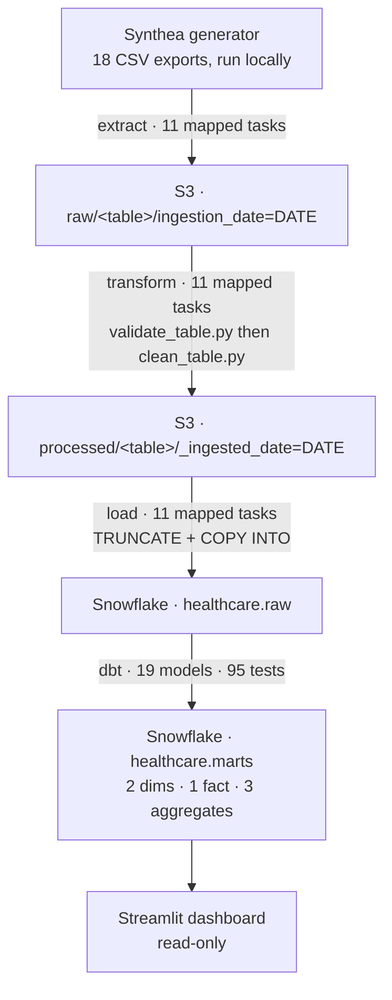
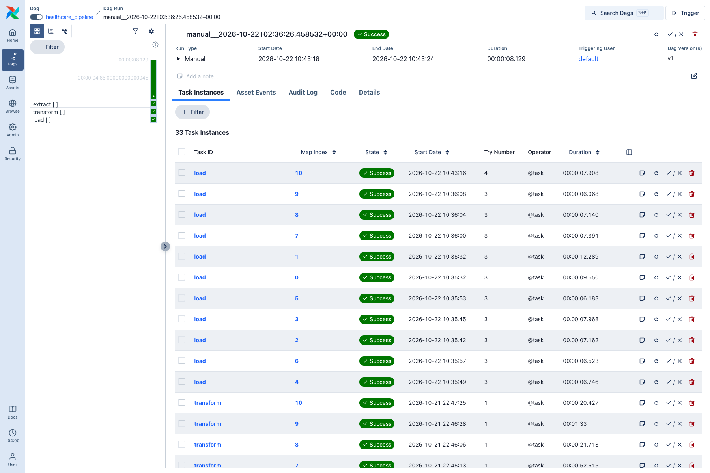
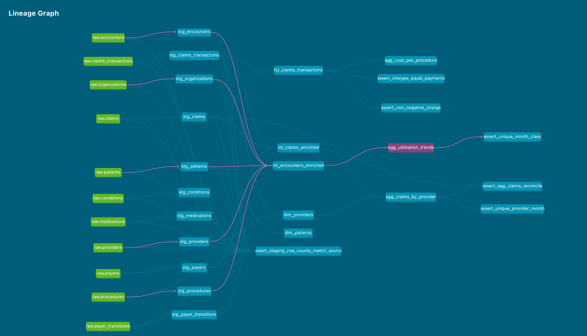
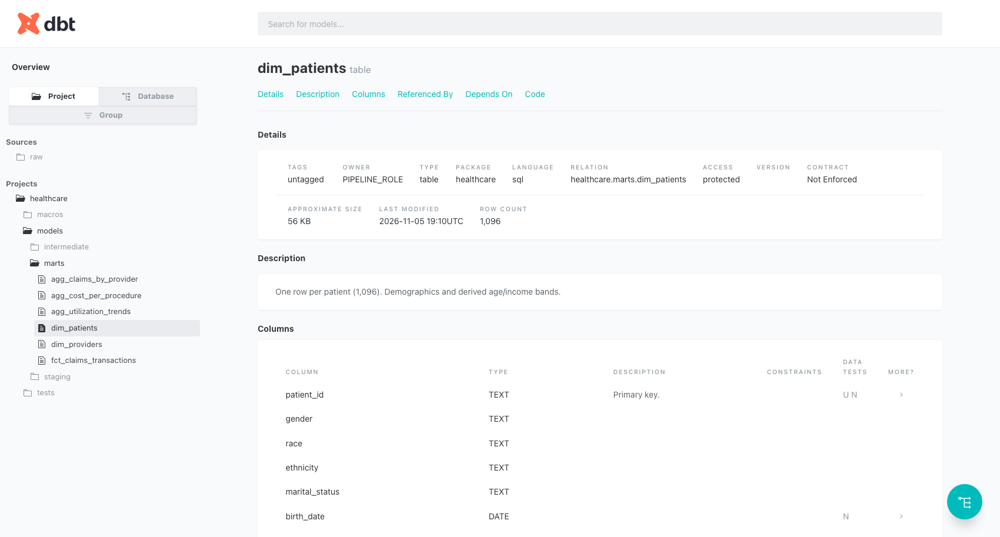
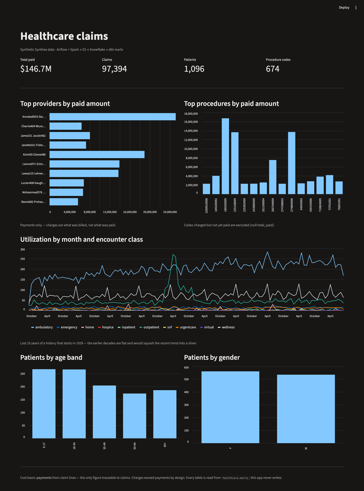

# End-to-End Healthcare Claims Pipeline

A batch data pipeline that turns raw synthetic healthcare claims into
analytics-ready tables. Synthetic patient data is generated locally, landed
untouched in object storage, cleaned and typed with Spark, and orchestrated
end-to-end by Airflow — all containerised, with least-privilege cloud
credentials and a data-quality gate between every stage.

The domain is deliberately claims-shaped: patients, encounters, procedures,
claims and claim line-item transactions. That gives a realistic mix of narrow
dimension tables (10 payers) and a wide fact table (902,713 claim
transactions), which is the point — the pipeline has to handle both.

---

## Architecture



Two things run alongside that line. **GitHub Actions** rebuilds the project on
every pull request into `ci_staging` and `ci_marts`, so a branch can never
overwrite what the dashboard reads. And the DAG posts **one Slack message per
failed run** — a callback on the DAG, not on each of the 33 task instances.

---

## Pipeline

One DAG, `healthcare_pipeline`, with three stages. Each stage is **one task
definition** fanned out over the eleven tables using dynamic task mapping — 33
task instances in total, but only three definitions to read.

```
extract (11)  ──►  transform (11)  ──►  load (11)
```



*A completed run — **33 task instances, all successful**. Three task definitions
fanned out to eleven mapped instances each; `Map Index` 0–10 is the table, in
alphabetical order. The graph panel on the left is the three-stage shape.*

| stage | what it does | lands in |
|---|---|---|
| `extract` | uploads each Synthea CSV, byte-for-byte | `s3://…/raw/<table>/ingestion_date=<date>/` |
| `transform` | validates then cleans with Spark | `s3://…/processed/<table>/_ingested_date=<date>/` |
| `load` | `TRUNCATE` + `COPY INTO` | `healthcare.raw.<table>` |

**One date for the whole run.** `{{ dag_run.run_after | ds }}` resolves once and
is handed to every stage, so `extract` writes `ingestion_date=X` and `transform`
reads exactly `X`. An earlier two-DAG design had to *guess* which partition to
read by listing S3 and taking the newest — this removes the guess entirely.

**Stage barriers.** Chaining mapped tasks means every `transform` waits for
every `extract` to finish. At eleven tables that costs about a minute. If
extraction ever became the long pole, the fix is per-table chaining via mapped
task groups.

**Concurrency is capped at two.** Each `transform` task starts its own Spark JVM
that wants the machine's cores; eleven at once would thrash.

**Granularity is per table, not per stage.** A `transform` task runs validate
*then* clean for its own table. So a failure on `claims_transactions` — 902,713
rows and about 60% of total runtime — retries that table alone rather than all
eleven.

**Full refresh, deliberately.** `clean_table.py` overwrites each
`processed/<table>/` directory wholesale, and `load` truncates before copying.
Simple and always self-consistent; it is the wrong choice for an append-only
fact table that grows daily, which is a trade-off discussed in the design notes.

---

## dbt

Three layers, 19 models, 95 tests. `staging` renames the raw tables 1:1,
`intermediate` joins them, `marts` answers the dashboard questions.



*The full lineage graph: eleven green raw sources, then staging, intermediate
and the six marts. `agg_utilization_trends` is selected (pink), which traces the
path that builds it — `raw.encounters` → `stg_encounters` →
`int_encounters_enriched` → the mart. The five `assert_*` nodes are custom
tests; they appear because dbt derives their dependencies from the models they
`ref()`.*

| layer | models | materialised as | purpose |
|---|---|---|---|
| `staging` | 11 | view | 1:1 with `raw`, columns renamed to snake_case |
| `intermediate` | 2 | view | claims and encounters joined and enriched |
| `marts` | 6 | table | 2 dimensions, 1 fact, 3 aggregates |



*`dim_patients`. The row count, size and last-modified come from Snowflake's
catalog; the description, tests and lineage come from the project. Views have no
row count — which is why the marts are tables.*

**Tests run at every layer**, not just at the top: 27 on the raw sources, 32 on
staging, 27 on the marts, and 6 custom. Each layer asserts what it guarantees,
so a failure points at the layer that broke rather than just reporting that
something is wrong.

---

## CI

Every pull request runs `dbt build` against Snowflake in GitHub Actions
(`.github/workflows/dbt.yml`). One command, not two: `dbt build` already runs the
models *and* their tests, per model in dependency order, and it skips a model's
children when its tests fail — so a broken staging model stops the marts from
being rebuilt at all.

The job writes to `ci_staging` and `ci_marts`, never to `staging` or `marts`.
Credentials arrive as repository secrets; the Snowflake private key is stored
base64-encoded and decoded onto the runner, because a PEM pasted raw into a
secret box loses its newlines.

Auth is a **key pair**, not a password: the account enforces MFA on password
logins, and no unattended runner can answer an MFA challenge. Key-pair auth
sends a signature, never the key.

The job checks the full PR diff **inside the workflow** and skips Python setup
and `dbt build` unless something under `dbt/` or `.github/workflows/` changed
(manual `workflow_dispatch` runs always execute). A trigger-level `paths:` filter
would leave a required status check stuck in *Expected* on docs-only PRs;
checking inside the job keeps the `dbt build` check green with zero Snowflake
cost.

Workflow files are watched as a **directory**, not by name, and linted with
`actionlint` before that check runs — seconds, no warehouse. `dbt build` cannot
validate YAML, so a PR that edits the deploy workflow needs a guard of its own;
without one, its first execution would be live against production tables.

**Publishing is separate from checking.** A PR build goes to `ci_*` and is then
discarded, so merging does not update `staging` or `marts` — the dashboard would
keep serving the previous numbers. `.github/workflows/dbt-deploy.yml` closes that
gap: every push to `main` runs `dbt build --target prod` onto the real schemas.
Same models, same tests; the target is the only difference between checking a
branch and publishing it. Merging already requires a green check, so the deploy
does not re-test — it publishes what CI validated.

---

## Dashboard



*Six read-only queries against `healthcare.marts`. The metrics are the numbers
this README quotes throughout — $146.7M paid, 97,394 claims, 1,096 patients, 674
procedure codes — and `sum(total_paid)` reconciles to `sum(paid_amount)` in the
fact table to the cent.*

```bash
python -m venv .venv && source .venv/bin/activate    # Python 3.12+
pip install -r dashboard/requirements.txt
set -a; source .env; set +a          # same SNOWFLAKE_* variables dbt reads
streamlit run dashboard/app.py
```

**Every query is cached for ten minutes.** Streamlit reruns the whole script on
each interaction, and every uncached query resumes the warehouse for a
60-second minimum — the cache is what keeps a clicking session to one resume.

**Payments, not charges.** Charges are what was billed; payments are what was
paid, and the only figure traceable to claim lines. Codes charged but not yet
paid are left out of the chart rather than sorted to the top, which is where
Snowflake puts their nulls.

---

## Status

| Stage | State |
|---|---|
| Synthetic data generation | ✅ 1,096 patients, 18 CSVs |
| Ingestion → S3 `raw/` | ✅ 11 tasks |
| Spark clean → S3 `processed/` | ✅ 11 tasks, ~9.8 min |
| Data-quality gate | ✅ Schema-fidelity check before every clean |
| Snowflake load | ✅ 11 tasks, counts verified |
| dbt transformation | ✅ 19 models, staging → intermediate → marts |
| dbt tests | ✅ 95, across sources, staging and marts |
| dbt docs | ✅ lineage graph + model pages |
| CI gate | ✅ `dbt build` on every PR, into throwaway `ci_*` schemas |
| Failure alerting | ✅ one Slack message per failed run |
| BI dashboard | ✅ Streamlit, six read-only queries over the marts |

The full chain — `extract` → `transform` → `load` — runs as **33 mapped tasks in
one DAG**, all green.

**~1.32M rows** across 11 tables, from 1,096 patients over ten years of
simulated clinical history.

---

## Tech stack

| Tool | Why |
|---|---|
| **Synthea** | Generates realistic synthetic patient data — no PHI, and the claims tables have real relational shape |
| **Airflow 3** | Scheduling, retries, and per-table fan-out; the pipeline's control plane |
| **PySpark 3.5** | Processes the whole dataset in one JVM without loading it into memory |
| **Amazon S3** | Cheap durable object storage; the `raw/` → `processed/` zone boundary makes reprocessing explicit |
| **Docker Compose** | Reproducible local stack — Airflow, Postgres, and the Spark runtime in one command |
| **Snowflake** | Columnar warehouse with native `COPY INTO` from S3 |
| **dbt** | Version-controlled SQL: 19 models, 95 tests, generated lineage |
| **GitHub Actions** | Gates every PR on `dbt build`, writing to a throwaway `ci_*` schema so a branch can never overwrite published tables |
| **Streamlit** | The dashboard: one Python file reading the marts, with no BI server to host |

---

## How to run locally

Requires Docker Desktop.

```bash
git clone git@github.com:amritmaniaryal/de-e2e-healthcare-pipeline.git
cd de-e2e-healthcare-pipeline

# 1. Provide credentials (never committed)
cp .env.example .env                    # AWS keys, S3 bucket, region
cp docker/.env.example docker/.env      # Compose settings + Fernet key
#    then edit docker/.env: set AIRFLOW_UID to `id -u` and generate a FERNET_KEY

# 2. Start the stack
cd docker
docker compose up -d
```

Airflow UI: <http://localhost:8080> (`airflow` / `airflow`).

Generate source data and place the CSVs at `synthea/output/csv/` — see
[Synthea](https://synthea.mitre.org/) for the generator. Then trigger the
pipeline:

```bash
docker compose exec -T airflow-scheduler airflow dags unpause healthcare_pipeline
docker compose exec -T airflow-scheduler airflow dags trigger healthcare_pipeline
```

A full run takes roughly 15–20 minutes: it uploads ~500 MB, re-runs Spark over
all eleven tables, then reloads Snowflake.

> New DAGs are created **paused** by default. A paused DAG will not run its
> tasks even when triggered manually — the run is created and then sits idle.
> Hence the `unpause` calls above.

### Required AWS permissions

The pipeline identity needs, scoped to the project bucket only:

```
s3:GetObject      s3:PutObject      s3:DeleteObject      s3:ListBucket
```

`s3:DeleteObject` is not optional: Spark commits output by writing to a
`_temporary/` prefix and then renaming, and on S3 a rename is a copy followed
by a delete.

### Required Snowflake setup

The `load` stage needs a connection named `snowflake_default` in Airflow:

```bash
docker compose exec -T airflow-scheduler airflow connections add snowflake_default \
  --conn-type snowflake \
  --conn-login <user> \
  --conn-password '<password>' \
  --conn-schema raw \
  --conn-extra '{"account":"<org>-<account>","warehouse":"<warehouse>","database":"healthcare","role":"<role>"}'
```

The `account` value must be the **org-qualified** identifier (`myorg-myaccount`),
not the bare account locator. A bare locator resolves only in Snowflake's
original US-West region; elsewhere the connector fails at login with a
misleading `404 Not Found` that never reaches password validation.

Snowflake reads the bucket through a **storage integration** rather than stored
S3 keys, so no AWS credentials are held in Snowflake and the role it assumes is
read-only and scoped to `processed/*`.

Each `raw` table is created once, outside the DAG:

```sql
CREATE TABLE healthcare.raw.<table>
  USING TEMPLATE (
    SELECT ARRAY_AGG(OBJECT_CONSTRUCT(*))
    FROM TABLE(
      INFER_SCHEMA(
        LOCATION    => '@processed_stage/<table>/',
        FILE_FORMAT => 'healthcare.raw.parquet_ff',
        IGNORE_CASE => TRUE     -- otherwise every column name needs quoting, forever
      )
    )
  );
```

---

## Repository layout

```
dags/                    Airflow DAGs
  healthcare_pipeline.py   extract -> transform -> load, one task per table
include/ingest/          helper code importable by DAGs
spark_jobs/              PySpark entry points
  common.py                shared session, S3 paths, IO helpers
  schemas.py               explicit per-table schemas + primary keys
  validate_table.py        schema-fidelity gate
  clean_table.py           dedupe -> Parquet
docker/                  Compose stack and Airflow image
```

**One convention throughout:** per-table differences live in `schemas.py` as
data; anything shared lives in `common.py`. The entry points stay thin, so
adding a twelfth table is a schema entry and a list append — not a new file.

---

## Data model

| Table | Rows | Primary key |
|---|---:|---|
| patients | 1,096 | `Id` |
| providers | 152 | `Id` |
| organizations | 152 | `Id` |
| payers | 10 | `Id` |
| payer_transitions | 37,700 | composite |
| conditions | 34,727 | composite |
| medications | 39,802 | composite |
| encounters | 57,592 | `Id` |
| procedures | 151,636 | composite |
| claims | 97,394 | `Id` |
| claims_transactions | 902,713 | `ID` |

`observations` (108 MB of lab results and vitals) is deliberately excluded —
it supports none of the target analytics, and excluding it keeps the free-tier
footprint small.

---

## Design decisions worth knowing

**Explicit schemas, never inference.** `inferSchema` costs a second full scan
of every file *and* guesses wrong on this data. It reads `ZIP`, `FIPS` and
`NPI` as `int`, silently destroying leading zeros; `procedures.CODE` holds
SNOMED codes up to 17 digits that overflow `int32`; and
`claims_transactions.PROCEDURECODE` contains values like `"03"`. Schemas are
declared once in `spark_jobs/schemas.py` and pinned at read time.

**A failed cast is invisible.** Spark does not error on a value it cannot cast
— it substitutes `null` and keeps the row. Row counts look perfect while the
data is quietly wrong. The validation gate catches this by reading each file
**twice**: once untyped, once with the declared schema. In the untyped read the
only possible source of a null is an empty field, so it establishes the true
blank count; any excess in the typed read is a value lost to a failed cast.

**One task per table, not one task for all tables.** `claims_transactions` is
60% of the total runtime. Per-table tasks mean a failure retries that table
alone, and the UI shows eleven independent statuses rather than one.

**Duplicates and null-key drops are counted separately.** These are different
problems: duplicates mean the source repeated a row, null keys mean the
*primary key is wrong*. Collapsing them into one number is how a broken key
goes unnoticed — see lessons below.

**CI builds into throwaway schemas.** `dbt build` writes, so on a pull request it
runs with `--target ci`: staging and intermediate land in
`healthcare.ci_staging`, the marts in `healthcare.ci_marts`. A plain `ci` target
was not enough — `generate_schema_name` returns a custom schema verbatim, so
`+schema: marts` ignored the target and a PR would still have rebuilt the real
marts. The marts schema now derives from `target.name`, which also removes a
`--vars` flag that could be mistyped into a silent fallback. Both schemas
**persist** between runs, because dbt creates schemas and never drops them: they
hold the last PR's output as scratch space. Nothing reads them, and the `dev`
target is the only thing that writes `staging` and `marts`.

---

## Lessons learned

**A nullable column in a primary key is a data-loss bug.** `payer_transitions`
was keyed on `(PATIENT, MEMBERID, START_DATE, PAYER)`. `MEMBERID` is null for
every government-payer row — Medicare and Medicaid have no member id — so the
clean step discarded **10,521 rows (28% of the table)** and reported it as
ordinary deduplication. The count was visible the whole time; it just looked
like normal duplicate removal because the two reasons were lumped together.
Key is now `(PATIENT, START_DATE, PAYER)`, verified unique across all 37,700
rows.

**Least privilege is discovered by running the real workload.** The scoped IAM
policy allowed `GetObject`, `PutObject` and `ListBucket` — enough to upload
500 MB successfully in Week 1, and not enough to write a single Parquet file in
Week 2. Spark's commit protocol renames via copy + delete, so every write
failed until `s3:DeleteObject` was granted.

**Airflow 3 manual runs have no logical date.** `{{ ds }}` is only populated
when a run has a `logical_date`, and manually triggered runs do not. The
template raised `UndefinedError` rather than rendering empty — which is the
right call, since a silent empty value would have written objects to
`ingestion_date=/`. Fixed with `{{ dag_run.run_after | ds }}`.

**A paused DAG blocks manual triggers too.** Pausing is widely understood to
stop *scheduled* runs. It also stops a manually triggered run from doing
anything: the run is created, then sits in `queued` with every task instance at
`state = NULL`. Cost an hour twice before it was obvious.

**Test the mechanism, not the theory.** Three plausible fixes for preserving
empty CSV fields (`nullValue`, `emptyValue`, both) were all wrong, confirmed by
a ten-row fixture in about a minute. Reasoning about Spark's CSV options had
already produced two wrong answers.

**Snowflake changed the auth model mid-project.** `dbt build` stopped with
`Multi-factor authentication is required for this account` — the account now
enforces MFA on password logins, which blocked local runs and CI at the same
time. Key-pair auth was the fix: each session sends a signature, never the key,
and no MFA prompt is involved. Two traps on the way: `env_var()` output is not
shell-expanded, so `SNOWFLAKE_PRIVATE_KEY_PATH=~/…` fails as "file not found";
and a PEM pasted raw into a GitHub secret loses its newlines, so it goes in
base64-encoded.

**A branch cut from an unmerged branch carries both.** The alerting work was
started from the CI branch before CI had merged, so its pull request contained
six commits — five of which were already on `main`. Git's cleanup is mechanical
(`git fetch`, `git rebase origin/main`, `git push --force-with-lease`), but the
cost is real: two rounds of "is this merged?" confusion, because `git status`
compares against *cached* remote refs and reports last week's state until you
fetch.

---

## Next

Nothing here blocks the project; it is ordered by what I would do first.

- **Schedule the pipeline.** `healthcare_pipeline` is still `schedule=None`, so it
  only runs when triggered by hand — the last unmet clause from the original
  plan. Alerting now exists, which is what makes an unattended run safe.
- **Make `fct_claims_transactions` incremental.** Rebuilding 902,713 rows on every
  run is the largest cost in the chain. The trade-off is the complexity of
  tracking what is new, which is why it was deferred.
- **Publish the writeup.** The last unchecked item on the checklist: a short blog
  or LinkedIn post pointing at this repo.

---

## Notes

All AWS resources run within free-tier limits, with billing alarms and
budget notifications configured on both actual and forecasted spend.

Patient data is synthetic, generated by Synthea. No real or de-identified
patient information is used anywhere in this project.
